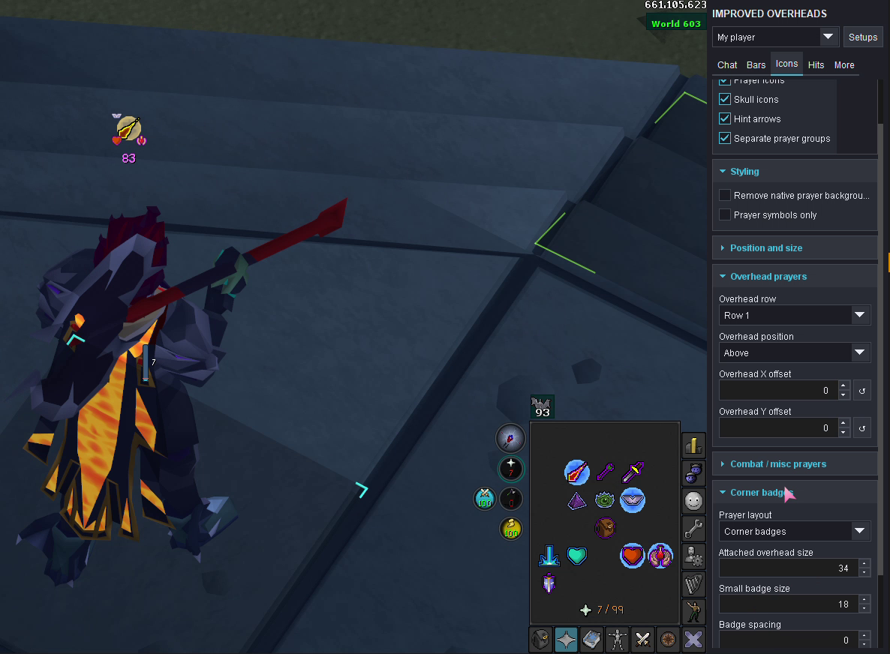

# Improved Overheads

Customize overhead chat, health and resource bars, hitsplats, prayer icons and corner badges. Choose **My player**, **Party**, **Other players** or **NPCs** before editing; each group keeps its own appearance settings.

**Availability:** the first [Plugin Hub submission](https://github.com/runelite/plugin-hub/pull/20302) is awaiting review. This guide describes that submitted version.

To hide the sidebar icon while keeping the plugin running, enable **Hide side panel** in RuneLite’s regular plugin settings. Turn it off there to restore the panel.

## Getting started

1. Open the Improved Overheads side panel and select the actor group you want to customize.
2. Choose **Chat**, **Bars**, **Icons**, **Hits** or **More**. Expand Display, Styling or Position and size for the controls you need.
3. Begin with visibility and placement, then adjust size, fonts, colors and effects. Settings for one actor group do not change the others.
4. Use **Setups** to save a named appearance or copy settings between actor groups.

RuneLite’s normal plugin settings contain four quick visibility switches for your own overhead chat, health, head icons and hitsplats. Detailed controls live in the side panel. Turning a component off hides it; disabling the plugin restores the native overhead display.

## Health and resource bars

Under **Bars**, Health, Prayer, Run energy and Special energy have separate sections. Supported resources offer **Numbers only**, **Bar only** or **Both**, with independent fonts, colors and **On bar**, **Above bar** or **Below bar** number placement.

Choose horizontal or vertical bars, OSRS or Modern styling, fill direction, backgrounds, borders, opacity, gradients, damage trails and segments. Your own run and special displays can hide while full and return when their values drop. Low-HP and low-prayer colors are optional.

Health information depends on the actor:

| Actor | What the display can show |
| --- | --- |
| My player | Exact current and maximum HP, or a percentage. |
| NPCs | Estimated current HP from the visible health bar when maximum HP is known; otherwise a visible percentage. |
| Other players | Visible health percentages. |
| Opted-in party members | The most recently received shared values, until they expire. |

Target/in-combat visibility choices and NPC-ID exclusions can reduce clutter. Special encounter shields and charge bars retain their native displays. **Native NPC UI IDs** preserves complete native overheads for selected NPCs, including transformed IDs.

## Prayer symbols, rows and corner badges

[Watch the 35-second demonstration](docs/media/prayer-styling-and-corner-badges.mp4): prayer background controls, corner badges, regular rows and toggling the main overhead while secondary prayers remain active. Recorded in a local test build; the documentation copy has no audio.

**Icons → Styling** has two different background choices:

| Setting | Result |
| --- | --- |
| Remove native prayer background | Removes the original backing while retaining custom row frames and corner-badge backgrounds. |
| Prayer symbols only | Removes both the original backing and the custom prayer backgrounds. |

Both retain the prayer symbols, supported resource-pack artwork and saved background choices. They start off and can be set separately for each actor group. Unrecognized native artwork is left unchanged.

Enable **Icons → Display → Separate prayer groups** for independent overhead and combat/misc prayer positions, offsets, sizes and Row 1/Row 2 assignments. Protection prayers, Redemption, Smite and Retribution form the overhead group and default to Row 1. Groups sharing a position and offsets use a centered layout; empty rows leave no gap.

For your own player, enable **My combat/misc prayers** and choose **Corner badges** under **Icons → Corner badges**. Up to four secondary prayers attach to the visible overhead prayer icon. Adjust **Attached overhead size** and **Small badge size** separately. Badge backgrounds start off and have their own colors.

Extra prayers stay visible in their regular row. Empty row space collapses while the overhead is active, bringing icons closer to your player. Turning the overhead off returns secondary prayers to their saved regular row, position and size. **Regular rows** keeps the ordinary arrangement.

Row 1 and Row 2 have separate frame shapes, background/border colors and opacity. Optional drain/refill effects follow your prayer points or available shared party prayer; unknown or expired values keep a static background. The prayer tick sweep follows observed decreases and does not predict future drain.

Other players retain only their visible overhead icons. The local combat/misc display can include defence, regeneration, Preserve and Protect Item as well as offensive prayers.

## Hitsplats and restoration

Under **Hits**, choose OSRS, Modern or numbers-only artwork, then set size, lifetime, opacity, motion and layout. Modern backgrounds have separate damage, miss and status styling. Special encounter indicators keep their original artwork.

HP and hitsplats use **Native** positioning on a fresh install. **Bars → Health → HP position and size → Native** keeps HP beneath prayer icons, including when the health bar appears after a prayer. Existing saved placements and offsets are preserved.

**Hits → Position and size → Native** keeps hitsplats anchored on the target while retaining your style, layout, motion and manual offsets. Side placements use the configured layout and overlap handling. Scrolling layouts support upward/downward motion in one to four columns.

**My player → Hits → Healing** and **Prayer restoration** add optional floating splats after an observed HP or prayer increase. Each has independent icon/number choices, fonts, colors, duration, position and zoom scaling. They start off. Disable overlapping Vitality displays to avoid duplicates.

Inventory-item hover previews are separate: they use RuneLite’s Item Stats calculations to show immediate positive HP/prayer restoration. They do not trigger the restoration splats.

## Chat, names and spacing

The **Chat** tab controls fonts, colors, shadows and effects. Removed or replaced actor text from Chat Filter is respected. Your own typed color/effect prefixes are supported; other players’ original prefixes are not available through the public API.

Names have independent visibility and relationship colors. Optional local poison, venom and disease badges reflect observed status; the NPC target badge follows your current interaction.

Place components above, below, left or right of actors with offsets and optional camera zoom scaling. **More → Spacing** controls the gap, alignment outlines and viewport containment. Continuously visible components retain spacing as chat and hitsplats appear or expire. **Reflow spacing** compacts them again.

## Party resources and timers

Party sharing starts off. **Party → More → Timers and party** can share your name, HP, prayer, run and special energy through your existing RuneLite party. Configure the received display under **Party → Bars**. Values are last received, RuneLite rounds run energy, and old values expire after the configured lifetime. **Refresh party data** requests another snapshot.

Importing an appearance does not enable or disable sharing. Ordinary other-player bars do not reveal private resource values.

Optional HP regeneration timing requires RuneLite’s Regen Meter. Independent HP-cape and Rejuvenation timing stays hidden. Poison/venom timing starts after a visible damage tick and stops at cure or when an expected tick is overdue; it is an estimate.

## Saving and transferring appearances

Save up to 12 named **Setups** per RuneLite profile. Export or copy JSON, open Setups in the destination profile, preview the changes and apply them. Actor settings can be copied between groups and edited independently afterward.

**Hits → Hitsplat themes** has its own presets and up to 12 named themes. Theme imports affect hitsplat appearance without changing hit filters or other overhead components.

**Undo last apply** reverses the latest applied setup/theme changes when there have been no conflicting edits or profile changes. Individual position offsets also have reset controls.

## Compatibility and support

Improved Overheads replaces the actor overhead renderer. Complete renderers such as Customize a Lot and Custom HP Bar are declared conflicts. Keep special encounter displays intact and avoid enabling overlapping resource or restoration overlays when comparing appearances.

[Report a problem or suggest a feature](https://github.com/wukuna/improved-overheads/issues). Include the actor group, tab/settings, display mode, other overhead plugins and a screenshot where helpful.

## License and attribution

Based in part on Customize a Lot by Ruined Heir, under the BSD 2-Clause license. See [LICENSE](LICENSE) and the bundled third-party license notices.
